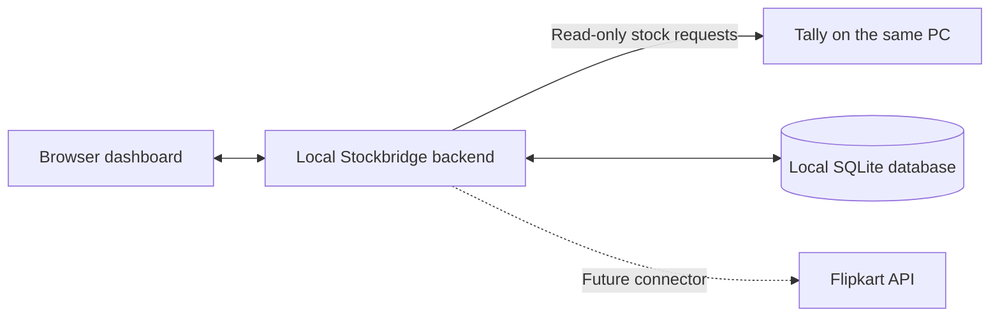

# HingadTyre customer setup

This repository is developed separately from the customer's Tally computer. Development uses the sample workspace and HTTP fixtures; Tally is not required on the developer's machine. HingadTyre is the first customer, and the seller account observed in Flipkart is **HINGADTYRES**. Keep this customer context for account and listing validation.

The current build supports local review and read-only Tally discovery. It is not ready to enable live marketplace synchronization: Flipkart authorization/import, location verification, durable publishing and production recovery remain delivery work.

**Baseline checked:** commit `6a55cb2230ac6ac08635d37aa1bdc0cd496a0256`, on 2026-11-07. The instructions below distinguish the current technician-assisted pilot from the proposed customer release. They are not evidence of a completed installation on HingadTyre's computer.

| Capability                                                          | Available in the current build?                                                                |
| ------------------------------------------------------------------- | ---------------------------------------------------------------------------------------------- |
| Run from a source checkout with Node.js 24                          | Yes, after dependency installation and build                                                   |
| Separate sample and customer databases                              | Yes; SQLite creates them automatically                                                         |
| Discover companies and read Tally stock                             | Implemented; compatibility and balances need verification on the customer's Tally installation |
| Import authenticated Flipkart listings/orders                       | No                                                                                             |
| Publish stock manually or automatically                             | No; the server rejects publishing requests                                                     |
| Create a verified database backup                                   | Yes, manually                                                                                  |
| Restore/import a backup, scheduled backups, Windows startup/service | Not implemented                                                                                |
| Customer installer or ready-to-run release ZIP                      | Not built                                                                                      |

Cloning is sufficient to obtain the code for a supervised pilot. It does not install Node, build the app, copy the developer's data, or supply the unfinished Flipkart integration. The recommended customer distribution is a versioned Windows installer, described in section 7.

## 1. Prepare the customer's computer

- Choose the Windows computer where the customer normally opens Tally and creates bills. Run this local backend on that same computer; the current connector accepts only local addresses.
- Record the Tally product/version, company names, inventory base units and godowns used for marketplace stock. Do not combine companies with similar names.
- Have the customer's Tally administrator available for connection configuration and the authorized HINGADTYRES seller user available for Flipkart authorization.
- Install [Git for Windows](https://git-scm.com/install/windows) and [official Node.js 24.x](https://nodejs.org/en/download). Select **24.x** explicitly: this application's current version range excludes Node 25 and 26, even if the download page advertises a newer LTS. Reopen PowerShell after installing them.
- Use a normal writable local folder, not a network share or a folder synchronized by OneDrive/Dropbox. The following pilot location is under the current Windows user's LocalAppData.

### Download the verified code

Run on the **customer's computer in PowerShell**. These are instructions for a new installation, not commands to run against the developer's existing checkout:

```powershell
node --version
npm.cmd --version
git --version
```

The first command must report `v24.x`. If any command is unavailable, finish installing its tool before continuing.

```powershell
$stockbridgePilot = Join-Path $env:LOCALAPPDATA 'StockbridgePilot'
New-Item -ItemType Directory -Force -Path $stockbridgePilot | Out-Null
Set-Location -LiteralPath $stockbridgePilot
git clone https://github.com/hingadtyre/TallyIntegration.git app
if ($LASTEXITCODE -ne 0) { throw 'Clone failed; stop and resolve it before continuing.' }
Set-Location -LiteralPath (Join-Path $stockbridgePilot 'app')
git checkout --detach 6a55cb2230ac6ac08635d37aa1bdc0cd496a0256
if ($LASTEXITCODE -ne 0) { throw 'Could not select the verified version.' }
```

`$stockbridgePilot` holds the installation folder; `Join-Path` combines Windows path components. `New-Item` creates the folder, `-Force` permits an existing parent, and `Out-Null` hides its directory listing. `Set-Location -LiteralPath` enters that exact folder. `git clone` downloads the source into `app`; `checkout --detach` pins the tested commit instead of following later development automatically. Detached HEAD is expected for this pilot. Each exit-code check stops the instructions after a failed Git command. The repository is public; the customer does not need write access just to download it.

A source ZIP downloaded from that exact commit is an alternative when Git is unavailable. Extract it into a writable local folder, enter the extracted root, and continue below. A source ZIP still requires Node and the build steps; it is not a packaged customer application.

### Install, verify and start

From the checkout root, **PowerShell**:

```powershell
npm.cmd ci
if ($LASTEXITCODE -ne 0) { throw 'Dependency installation failed.' }
npm.cmd run verify
if ($LASTEXITCODE -ne 0) { throw 'Verification failed; do not start the customer pilot.' }
npm.cmd start
```

`ci` installs the versions recorded in `package-lock.json`; `verify` checks formatting, code rules, TypeScript, tests and the production build. Tests use fixtures and temporary databases, not the customer's Tally. `start` launches the real workspace. Using `npm.cmd` avoids requiring PowerShell execution-policy changes to run npm. These commands assume the customer's normal internet connection; the developer machine's corporate proxy configuration is not part of the customer setup.

Open **http://127.0.0.1:4310** in a browser on the same computer. The terminal should show the dashboard address and say marketplace publishing is disabled. Keep that terminal running. Close the browser freely; stop the backend with **Ctrl+C** when needed. No Windows startup service is installed by these commands.

On first live start, SQLite creates `.data/live.sqlite`. Stock and listings are empty until imported. A disconnected account label, **HINGADTYRES**, appears; it is a saved setup label, not proof of API authorization. To view demonstration data separately, stop the live process and use `npm.cmd run demo`, then open port **4311**. Never copy the developer's sample database into the customer's live workspace.

For subsequent live starts, open PowerShell, enter the same checkout root and run `npm.cmd start`. The existing Windows launcher, `scripts/app.ps1 -Mode Live`, is another source-checkout option where local script execution is permitted. It needs development dependencies installed; it is not yet a launcher for a production-only package.

## 2. Enable Tally's local connection

On the **customer's** computer:

1. Open TallyPrime and load the intended company.
2. Where available, open **F1 (Help) → Settings → Connectivity → Client/Server Configuration**, select **HTTP Server** or **Both**, and set the port to **9000** or another unused port. Another documented route is **Alt+Z (Exchange) → Configure → Client/Server Configuration**. Older XML documentation uses **F1 → Settings → Advanced Configuration**. Follow the installed release's labels; do not assume a particular release-number split between these menus.
3. Save the configuration and follow any Tally prompt to restart; reload the company afterward. Initial Tally connectivity changes may need a Tally restart. Later changes to this app's polling intervals do not.
4. Keep this endpoint local. This app does not need a public Tally port or a router port-forward. ODBC is not used by the XML connector.

References: [current Tally connectivity guide](https://help.tallysolutions.com/building-tunnel-based-connectivity-for-tallyprime-integrations/), [older XML configuration](https://help.tallysolutions.com/xml-integration/), [integration prerequisites](https://help.tallysolutions.com/pre-requisites-for-integrations/), [connectivity and restart guidance](https://help.tallysolutions.com/set-up-for-data-synchronisation/). Only the local HTTP connection is needed; do not follow the external tunnel, public-IP or Tally-to-Tally synchronization parts of those guides for this pilot.

## 3. Discover and verify company stock

1. In the app, open **Settings** and enter `http://127.0.0.1:9000/`, replacing 9000 if the customer configured another port. Save settings.
2. Open **Connections → Check & discover companies**. Select the required company in the top bar.
3. Compare several stock items with Tally's stock summary for the same company and date: include positive, zero, negative and newly created items. An unknown value is shown as a dash; it must not be treated as zero.
4. Check that an unmapped item is visible, and that switching companies changes the stock shown without combining balances.
5. Use a customer-approved test entry or an ordinary real transaction to verify changes after billing and receiving stock. Refresh should observe Tally's resulting balance, without writing back to Tally. Do not create a fictitious live bill solely for testing.

Live Tally checks default to **30 seconds after the preceding check finishes**, with longer waits after failures. Change the interval in Settings without restarting this app. Discovery can import multiple loaded companies; the dashboard selection filters which company's records are displayed. No balances are combined. Newly added Tally items arrive on a successful stock read and are saved by their stable company/item identities; the database is not a fixed list populated only at installation. Brands are not extracted by the first Tally reader, so live brand filtering will need verified brand data before it is useful.

This first adapter reads company-wide closing balances. Godown-specific extraction and source-to-marketplace location mapping must be completed before publication. Stable IDs, the company projection and balance-period semantics still need live verification; passing mock tests does not replace these checks.

If discovery fails, inspect **Activity → Diagnostics** and check Tally is open, a company is loaded, and both ports match. A failure preserves old observations and blocks review that requires fresh data. Do not replace an unknown balance with zero to bypass validation.

## 4. Connect the HingadTyre Flipkart account

**This section describes preparation and the future connection workflow. The current app cannot complete this step. The provider authorization service, customer connect flow and listing importer are not implemented, and registering an API application will not activate them.**

The HINGADTYRES browser session and inspected listing evidence remain valid setup context. Browser sign-in alone does not authorize this app's API access.

The accepted product model uses the Stockbridge provider's registered Flipkart partner application and separate authorization from each customer. A small provider-operated HTTPS authorization service handles the callback and protects the shared application secret. The dashboard, Tally connection, stock processing and SQLite database remain on the customer's computer. Customers do not create or share seller self-access credentials for this product. See [the provider authorization decision](adr/0003-provider-managed-flipkart-authorization.md) and [Flipkart's application and authorization guidance](https://seller.flipkart.com/api-docs/FMSAPI.html#application-registration).

The planned customer release has no invitation, activation code or separate Stockbridge signup. Anyone receiving the installer can install it, connect their own seller account and complete setup. The provider prepares and operates the shared authorization service once; it does not approve each customer's installation. Flipkart consent and stock/mapping verification still apply to each customer.

### One-time provider setup before customer onboarding

These prerequisites remain outstanding. No provider application has been registered and no authorization service has been deployed by this project.

1. Register the Stockbridge provider through Flipkart's partner process, complete its verification and obtain the required application access.
2. Deploy and operate the HTTPS authorization service, then configure the application's required callback. The local dashboard address is not this hosted callback. Keep the shared application secret on the provider service, never in the installer or a customer database.
3. Implement and verify a connection flow that binds each authorization result to the initiating customer installation and verifies the seller identity. Complete protected per-customer credential handling, renewal and failure recovery before making connection available.

Provider hosting and credential maintenance continue after setup. Do not put secrets in source control, chat, dashboard screenshots or portable backups.

### Each customer's connection and consent, once implemented

1. Start the Flipkart connection from the customer's local Stockbridge setup. The connection flow opens Flipkart's authorization page for the provider application.
2. The customer signs in to their own seller account on Flipkart and reviews the actual application, permissions and terms before authorizing it. The seller password is not a Stockbridge setting. Do not assume separate per-feature permission switches exist just because the product needs inventory and order APIs.
3. After authorization, Stockbridge verifies the authenticated seller identity and associates it with the initiating local installation. Confirm that the connected account is the intended one, HINGADTYRES for this first customer.
4. Read that seller's inventory locations and existing listings, then observe current quantities. Record when each observation was read and complete the mapping checks below.
5. Verify approved-order coverage before using sales allowances. A decrease in shared Tally stock alone cannot identify which duplicate listing sold. A completed connection does not enable publication until the remaining release checks in section 6 are satisfied.

Token details belong in the connector implementation rather than customer copy-and-paste commands. See [Flipkart token flows](https://seller.flipkart.com/api-docs/FMSAPI.html#generating-access-tokens) and the [onboarding research note](integration/customer-onboarding-research.md).

## 5. Validate listings and packs

This becomes a live customer step after authenticated listing import is delivered. In the current live workspace there are no imported Flipkart listings to map; sample mappings only demonstrate the workflow.

- Import the customer's existing listings; mapping must not create Tally stock items or Flipkart products.
- Match the exact stock item, tyre brand/model/dimensions, base unit, listing and destination location.
- Prefer a reliable sellable-set field. Shipping-package count can be used for this customer's one-tyre-per-package practice only after verifying it for the particular listing. SKU endings, package IDs and title digits are not pack evidence.
- Recheck the known example `145/70R12_X3_2_2` / `VTEGYHJKPW2NFEYP`: the browser showed set of two and two packages. Compare the authenticated response. This example does not verify every listing.
- Compare all mappings for mismatches before enabling any positive publication. Missing or conflicting evidence keeps the affected mapping blocked.

## 6. Complete the first live release

The app currently rejects publication requests. Before releasing that capability, finish authenticated order coverage, allowance activation, durable jobs/read-back, godown/location mapping, safe recovery, scheduled backups and customer installation packaging.

Then perform a small customer-reviewed publication and verify the result in Flipkart before expanding scope. Confirm the full shared-stock tyre rule, manual limited-sales behaviour, persistent zero hold and Pause semantics from the [approved architecture](design/architecture.md). For a listing with one remaining allowed unit, selling that unit must exhaust its allowance even while Tally still has stock; larger allowances decrease by the units sold. Cancellation or purchase must not refill an allowance automatically.

Choose a writable backup folder and verify **Back up now**. The current manual backup is available; scheduled retention and import/restore are pending. Closing the dashboard leaves the running backend active, but closing its terminal stops it until Windows service packaging is implemented. Tally must be open and the relevant company loaded for fresh stock reads.

Record the customer/version, verified company IDs, source and marketplace locations, account identity, mapping verification date, live test outcome, backup destination and support owner. Record identifiers and outcomes, never credentials.

## 7. Database and customer packaging

### The database is already connected

SQLite is a full relational database embedded in the backend. The customer does not install a separate database server or manually create tables. The app opens the file and runs its schema initialization/migrations. Current tables include companies, seller accounts, stock items, listings, proposals, settings and activity.



For the pilot folder above:

| Path under `%LOCALAPPDATA%\StockbridgePilot\app` | Purpose                                                                              |
| ------------------------------------------------ | ------------------------------------------------------------------------------------ |
| `src`, `dist`, `package.json`                    | Application source/build and package metadata                                        |
| `.data\live.sqlite`                              | Customer observations, mappings, drafts, policies, settings and activity             |
| `.data\demo.sqlite`                              | Separate demonstration data, only if demo mode was started                           |
| `.data\live.diagnostics.ndjson`                  | Local technical logs                                                                 |
| `.data\backups`                                  | Default manual backup destination; change it in Settings                             |
| `.data\migration-backups`                        | Verified safety copies created when an existing schema needs its supported migration |

`.gitignore` excludes `.data`, so neither cloning nor a normal Git push transfers these customer records. Restarting in the same installation reopens its database. Re-cloning into a different folder creates a different workspace; it does not restore the original mappings. Tally remains the source of physical stock, and Flipkart remains the source of its listings and observed marketplace stock. This database stores the application's own operational state and observations; it is not a backup of the customer's accounting company.

The data path is currently derived from the backend's working directory. `npm start` from the package root and the PowerShell launcher keep that predictable. There is no configurable ProgramData/AppData migration or data-directory setting implemented yet. The database lives beside the code today because this is a source checkout; it should have a stable independent location in the customer package.

### Recommended delivery: a Windows installer

For routine customer use, deliver a versioned installer with:

- The compiled backend/dashboard, a tested Node runtime and required runtime dependencies. Git, npm installation and compilation should not be customer tasks.
- A shortcut opening the local dashboard and a background service with automatic startup and restart after failures. A browser close must not stop stock checks; the PC must remain running, and Tally must be open with the relevant companies loaded.
- Application files under `%ProgramFiles%\Stockbridge`, and writable service data/logs under an explicitly permissioned `%ProgramData%\Stockbridge` subfolder. Resolve the standard Windows folders rather than hard-coding a drive letter. A per-user installation could instead use `%LOCALAPPDATA%\Stockbridge`, but its runtime/credential ownership must be consistent. [Windows folder definitions](https://learn.microsoft.com/en-us/windows/win32/shell/knownfolderid)
- A tested upgrade procedure that backs up data, stops the old process, applies only supported migrations, starts one new process and verifies health. Uninstall must preserve customer data by default, with deletion a separate explicit choice.
- Protected credential storage, scheduled verified backups, a tested restore flow and visible version/connection status. Source refresh and marketplace reconciliation must precede resumed publication after restore.

These are release requirements, not existing installer features. An interim portable ZIP is possible, but it needs a dedicated launcher, bundled runtime and stable external data path. Copying the current developer folder or shipping the existing source-checkout launcher with development dependencies removed is not a completed packaging solution.

SQLite remains suitable for one local backend. A remote database is not needed just to make data persistent. If the product later needs centralized operations or many concurrent writers, evaluate a server database such as PostgreSQL behind the backend. That migration needs schema conversion, transaction changes, authentication and recovery testing; it is not a connection-string switch. A small server can also use SQLite behind its API, so adding a second dashboard user alone does not dictate a database replacement. [SQLite deployment guidance](https://www.sqlite.org/whentouse.html)

Do not put the active SQLite file on a network share or use file synchronization as database replication. This app uses SQLite WAL mode, which requires its readers/writers to be on the same host. Multiple future clients should talk to an application API. A cloud-hosted backend would still need a connector on the customer's computer to reach local Tally. [SQLite WAL constraints](https://www.sqlite.org/wal.html)

## 8. Daily use, backup and support

For the current pilot, open Tally/load the company, start the app from its original folder, and open port 4310. Check the selected company and observation time. Keep the backend terminal open. After a reboot or terminal closure, start it manually again. Leaving a laptop asleep interrupts the checks.

In **Settings → Backup folder**, choose an absolute writable path, save it, then select **Back up now**. Confirm the verified result. A separate disk/location can protect against failure of the application disk; choose a customer-owned destination. Backups contain business data and need appropriate access protection. A copied backup may be moved off-machine after it is complete; the active database must stay local.

Use the app's backup operation rather than copying just an active `.sqlite` file: committed changes may still be in companion WAL files, whereas the implemented backup includes them. Scheduled backups and restore/import are not implemented. Preserve the verified copy and its manifest; do not treat manually overwriting the active database as a supported recovery procedure.

Before any technician-assisted update, create and verify a backup, stop the backend with Ctrl+C, retain the data directory, and install only a reviewed version with a compatible migration. Do not replace the entire checkout or use cleanup commands that erase ignored `.data` files. Do not downgrade a migrated database blindly. The current v1-to-v2 migration safety copy is not a general updater/rollback system.

| Symptom                                  | Check                                                                                                                |
| ---------------------------------------- | -------------------------------------------------------------------------------------------------------------------- |
| Dashboard does not open                  | Backend terminal is running, startup succeeded, and browser uses 4310 for live or 4311 for sample on the same PC     |
| Wrong Node version                       | Install/select 24.x; reopen the terminal and check `node --version`                                                  |
| Company/stock does not import            | Tally is open, company loaded, configured HTTP port matches; inspect Activity → Diagnostics                          |
| Stock differs from Tally                 | Compare the same company/date/base units; current export is company-wide, not a godown balance                       |
| No Flipkart listings or Connect workflow | Expected current limitation; the real importer/authorization flow has not been delivered                             |
| Publishing unavailable                   | Expected current limitation; there is no setting that enables the missing integration                                |
| Data appears missing after reinstall     | Confirm the original installation/data path; stop before creating mappings in a second workspace and involve support |
| Backup fails                             | Saved destination exists/is writable and has free space; retain the original live database                           |

Use **Activity → Business activity** for user-facing history and **Activity → Diagnostics** for technical logs. Share the application version, relevant request reference, company/location identifiers and a redacted error description with support. Keep credentials and full customer payloads out of support messages.
