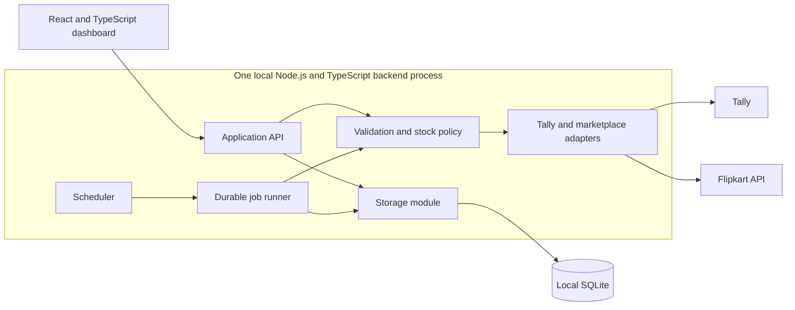

# Tally to marketplace inventory architecture

**Status: Approved target architecture.** The seller approved the consolidated architecture and dashboard layout on 2026-11-07 and authorized implementation. The initial local foundation is implemented; [README](../../README.md) records its delivered scope and remaining limitations. The diagram and workflows below include unfinished capabilities. Live marketplace publishing still requires connector and durable publication/recovery implementation as well as authenticated verification. The decisions incorporate the completed design interview, including Pause, allowance consumption, and Auto publication.

## Outcome and scope

Run on the Windows machine that can access Tally. Start with Flipkart tyre listings, homogeneous packs, and existing products/listings. Show every stock item in the selected Tally company, including unmapped items, then associate listings with their source item. Keep companies separate and explicitly select which Tally stock locations supply each marketplace inventory location.

Every eligible duplicate listing and pack uses its mapped item's full physical stock. There is no exclusive allocation or reservation between listings. The seller accepts concurrent-sale exposure before Tally billing and synchronization. The advertised minimum of five is an agreed business policy, not proof of five physical packs or a verified platform-wide promotion rule. The reported one-unit cart restriction remains a seller-provided operating assumption.

Additional marketplaces, remote hosting, and multiple users are future extensions. Account identity is explicit throughout so adding seller accounts does not require redesigning the stock model.

## Application boundaries

| Module                   | Responsibility                                                                                                                                                                                      |
| ------------------------ | --------------------------------------------------------------------------------------------------------------------------------------------------------------------------------------------------- |
| Dashboard                | Company/account context, item/listing rows, observations, editable proposals, review, actions, settings and searchable history. Never access SQLite or marketplace credentials directly.            |
| Application API          | Apply user commands, scope actions, validate versions, persist settings/drafts/policies and create durable jobs. Bind to loopback by default.                                                       |
| Policy and validation    | Verify identities, mappings, units and pack evidence; calculate complete packs and the named Flipkart tyre policy; apply allowances and holds. Shared by manual and automatic publication.          |
| Scheduler and job runner | Poll sources, discover items, observe orders, reconcile holds, process publication and verification, retry safely, and run backups. Modules in the same backend process, with work saved in SQLite. |
| Adapters                 | Hide Tally and marketplace authentication, transport, response validation, pagination, locations and API-specific batch/results handling. Preserve source identifiers and observation times.        |
| Storage                  | Own schema migrations, bounded transactions, observations, operational records, business history and consistent backups. Keep business policy independent of SQLite-specific queries.               |

The backend continues when the dashboard closes. Windows startup, controlled shutdown, restart after failure, upgrades and protected credential access must be packaged and verified. The application runtime and dependency versions are selected in [package.json](../../package.json) and [package-lock.json](../../package-lock.json). Windows lifecycle hosting and durable publication-job implementation remain to be selected and delivered; type checking does not replace validation of external responses.

## Durable identities and state

Use internal stable IDs and retain verified external IDs. Names, display titles and SKU text are labels, not global identity.

| Record                                            | Identity and retained facts                                                                                                                                                                                                                          |
| ------------------------------------------------- | ---------------------------------------------------------------------------------------------------------------------------------------------------------------------------------------------------------------------------------------------------- |
| Tally company, stock item and stock location      | Stable company identity; item and location identities scoped to that company. Store base units and source identity evidence. Verify rename, restore and reconnect behavior before relying on a Tally identifier.                                     |
| Seller account, listing and inventory destination | Marketplace plus verified seller account identity; listing identity within that account; destination additionally includes marketplace location. Retain seller SKU/product references without treating a SKU as unique across accounts.              |
| Stock mapping                                     | Company/item, explicitly selected source locations, destination, verified pack size, evidence/source/time and mapping version. Block ambiguous or contradictory mappings.                                                                            |
| Observations                                      | Tally stock, marketplace stock and order observations with source time, fetch time, version and validity/freshness. Keep observed stock distinct from desired and confirmed stock.                                                                   |
| Active policy                                     | Auto, Limited sales or manual out-of-stock hold; a separate Pause flag; company automation setting; policy generation and history. Pausing does not erase allowance or hold state.                                                                   |
| Allowance and consumption                         | Exact seller-account/listing identity, granted listing units, activation baseline/generation, remaining units and durable order-item consumption records. Never share a deduction with sibling listings or infer a sale from a stock balance change. |
| Proposal and bulk review                          | Exact destination set, original calculation, seller edits, captured source/mapping/rule/policy versions and review status.                                                                                                                           |
| Job and publication attempt                       | Destination, cause, desired quantity, policy/source versions, retry/verification state and per-destination outcome. Preserve uncertain in-flight outcomes across restart.                                                                            |

Publication is location-specific. Order attribution must resolve the exact listing and any location attribution required by the configured policy; unresolved attribution blocks affected allowance reconciliation rather than charging another listing or silently inventing a per-location allowance split.

## Calculation and publication precedence

Evaluate every dispatch again; a reviewed proposal is not an exemption from current validation.

1. **Connection and validation:** require authenticated destination access, verified company/item/account/location/mapping/pack identities and fresh required source data. With Tally unavailable, retain marketplace values and show stale/offline status; refresh before resuming. Missing or invalid inputs are blocked, never fabricated as stock zero. Limited-sales increases additionally require current order reconciliation.
2. **Publication permission:** automatic work requires company automation enabled and the listing not Paused. Pause blocks **all** automatic writes, including stock-zero changes, exhausted-allowance corrections and manual-hold enforcement. Observations, order accounting and alerts continue. Explicit manual publication remains available through the same validation path. Restore recovery separately blocks outbound work until reconciliation/review.
3. **Active policy:** a manual out-of-stock hold or an exhausted allowance targets zero. A positive allowance limits only its exact listing. Routine refresh, bulk calculation, restart and retries preserve these policies; changing back to Auto or granting new allowance is explicit.
4. **Stock calculation:** for valid physical base units `P` and verified positive integer pack size `S`, calculate `completePacks = floor(max(0, P) / S)`. The Flipkart tyre policy is `completePacks == 0 ? 0 : max(5, completePacks)`. For Limited sales, use the smaller of that result and remaining allowance. Zero complete packs always means zero, including packs of two, three, four or more. A hold's zero is an explicit policy, not a substitute for invalid data.
5. **Trigger and current job:** publish only for an eligible cause and current versions. For normal Auto, relevant Tally source-stock changes and explicit publish/resume actions can publish; marketplace-only differences are displayed without automatic refill. Limited sales and holds additionally reconcile their policy constraints. Never replay an obsolete positive quantity after a newer zero or policy change.

Pack evidence prefers reliable sellable-set data. The accepted fallback counts shipping packages only when one tyre per package is verified for the listing. Compare company item, tyre brand/model/dimensions, base unit, listing/product identity and available set/package evidence. Do not derive pack size from SKU suffixes, title digits, package IDs or package order. Metadata changes invalidate the affected mapping's verification.

## Modes and operations

| State or action                       | Effect                                                                                                                                                                                                                                                                                     |
| ------------------------------------- | ------------------------------------------------------------------------------------------------------------------------------------------------------------------------------------------------------------------------------------------------------------------------------------------ |
| Auto                                  | Recalculate on relevant Tally stock changes; publish eligible changed quantities. Report marketplace-only drift without replenishing it automatically.                                                                                                                                     |
| Limited sales                         | Allow a finite number of additional listing units, each one complete pack. Automatic stock changes remain active within physical availability and remaining allowance.                                                                                                                     |
| Allowance used up / Kept out of stock | Keep the desired quantity at zero until explicit new allowance or Auto. If marketplace stock becomes positive, queue and verify zero when automatic publication is permitted. Show pending/failed correction until confirmed.                                                              |
| Pause / Resume                        | Pause stops all automatic publication while observations and allowance consumption continue. Resume reads fresh stock and relevant orders, revalidates, and recalculates with the current policy. Parent actions affect their mapped listings and show mixed child state where applicable. |
| Edit proposed quantity                | Positive `N` means “Allow N more sales”; zero means a manual out-of-stock hold. The reviewed activation/publication action changes policy; an unsent draft changes neither Flipkart nor active policy.                                                                                     |
| Calculate / Refresh                   | Update saved observations or proposals. Preserve edited drafts and active policies. Refresh imports newly discovered Tally items without creating source products.                                                                                                                         |
| Publish reviewed changes              | Validate the exact destination set and captured versions, then create durable publication work. Show outcomes separately for each destination; sent does not mean confirmed.                                                                                                               |
| Remove mapping                        | Default: prevent positive jobs, reconcile in-flight work, explicitly send zero and verify before unlinking. Failure leaves a visible pending removal. Alternative: explicitly leave remote stock unchanged and stop managing it. Never delete either product.                              |

Mode, Pause, connection health, validation status and publication result are separate fields: a listing can be Paused, offline and awaiting confirmation simultaneously. Use text/accessibility labels, not colour alone.

## Allowance activation and sales accounting

Consume allowance at the **first qualifying approved Flipkart order observation, before Tally billing**. Consume the order item's quantity in listing units, not tyre base units. Persist stable account/order-item identity and already consumed quantity so repeated polls, notifications, status changes or retries cannot deduct again. A later Tally bill affects physical-stock calculation only; it does not consume allowance again. Do not subtract the sale a second time from marketplace-observed stock or write a corresponding stock deduction into Tally.

Activation must save a durable generation and baseline that excludes previous orders while accounting for orders arriving during publication. Reuse that activation on retry. Reconcile relevant orders before any increase that could reuse already consumed allowance; stale order coverage blocks increases. Exact status mapping, available-versus-pending inventory semantics, discovery coverage and activation boundary handling require authenticated integration evidence before enabling this feature.

Purchases, cancellations and returns never replenish allowance automatically. Show them for review. Exhaustion stays at zero until explicit action. Publication failure leaves the desired policy active with an honest pending/failed remote result. Pause can delay zero enforcement, and observation/API latency means zero cannot be guaranteed continuously between checks.

## Review, bulk actions and background work

Parent rows show unique Tally stock items; child rows show mapped listings and location-specific inventory. Display source quantity, title/SKU, verified pack size, observed quantity/time, proposed quantity and row actions. Low-stock highlighting defaults to five or fewer physical base units, configurable per item.

Bulk actions use selected listings when any are selected; otherwise all filtered matching listings across pages. Capture that destination set at review and show company, account, locations and count. Exclude unmatched siblings. New items or filter changes must not silently enlarge an already reviewed operation. If stock, mapping, pack, rule or active-policy versions change, mark affected proposals stale and require review again while preserving the seller's edit for comparison.

Company automation settings are independent of the displayed company. Poll without overlap and back off on failure. Initial interval candidates are 30 seconds for Tally, five minutes for marketplace stock and 15 minutes for catalog metadata. Order observation timing must meet allowance reconciliation needs and verified API limits; no unverified frequency is promised. All intervals are configurable in Settings without restarting Tally or the app: validate and save them, let the current run finish, then reschedule future work. Show effective interval, last success, next run and Refresh now.

Save jobs before sending. Serialize publication per destination, supersede obsolete queued quantities, and revalidate immediately before dispatch and retry. Give zero updates priority without violating destination ordering. Check each SKU/location outcome even after HTTP success; verify resulting marketplace stock. A timeout is an uncertain result to reconcile, not proof of failure. After outages/restart, refresh affected sources and policies before resuming pending work. One process owns publishing initially.

## Backups, restoration and history

Create consistent SQLite snapshots daily, before upgrades and on Back up now. Initially retain seven daily and four weekly backups. Verify the completed snapshot and manifest before declaring success or rotating older backups. Include settings, mappings, observations, policies/allowances, durable recovery records and retained business history. Exclude credentials from portable backups by default; protect them separately and reconnect accounts when needed. Export raw diagnostic logs separately.

Settings shows the backup folder, schedule/retention, last/next backup, failures and restore/import actions. Validate background-process write access when changing the folder; future backups use it immediately without restart. Existing files stay put unless the user explicitly requests a move/export. Keep manual and pre-upgrade/pre-restore safety backups distinguishable; their exact retention is an implementation choice.

Restore is replacement of this app's local state, not a merge or rollback of Tally/Flipkart. Validate the selected backup in staging, show its date/version/identities/counts, obtain the product's restore confirmation, stop publication, reconcile or record in-flight uncertainty and take a verified safety backup. Replace the database under exclusive access. Preserve this machine's connection/backup-path settings; do not import another machine's paths blindly.

Keep restored outbound work paused. Mark stock and drafts stale and do not replay restored pending jobs. Fetch fresh Tally stock, marketplace stock and order history; verify identities; reconcile restored policies with the preserved current state. Reconstruct allowance consumption across the backup gap so an allowance consumed after the backup cannot reopen. Show a reconciled review before resume. If order or policy history is insufficient, require explicit review/reset of affected listings instead of guessing. Database integrity alone does not establish safe restored stock.

Keep searchable business/item history for 90 days and rotated technical logs for 30 days initially, both configurable with export. Explain calculations, policy changes, publishing outcomes and settings changes. Diagnostics include time, level, module/operation, company/listing, run ID, duration, retry and errors; provide filters, search and bounded debug mode. Exclude credentials and unnecessary customer personal data. Log-retention cleanup must not delete active allowance/order deduplication records, unresolved jobs or hold state needed for correctness.

## Evidence and remaining integration checks

The [interview evidence](inventory-sync.md#official-source-findings) records official-source review and [observed package examples](inventory-sync.md#live-pack-size-evidence-from-hingadtyres). Those establish documented capabilities and inspected UI values, not authenticated access for this installation.

| Established evidence                                                                                                                                              | Still to verify before production use                                                                                                                                       |
| ----------------------------------------------------------------------------------------------------------------------------------------------------------------- | --------------------------------------------------------------------------------------------------------------------------------------------------------------------------- |
| Flipkart documents location-specific absolute stock writes, batches of up to ten SKUs and per-SKU outcomes.                                                       | Intended account authorization, actual response behavior, locations, throttling, inventory availability/pending semantics and read-after-write verification.                |
| Listing details document `packages[]`; order details document order-item/listing identity and quantity. A set-of-two listing was checked against its UI packages. | API package agreement, per-listing fallback eligibility, exact approved status, order discovery completeness, location attribution and allowance activation/reconciliation. |
| Tally documents company-scoped XML and JSON support from TallyPrime 7.0; live access needs Tally running with a company loaded.                                   | Installed version, supported interface, stable IDs, units/godowns, source-location extraction, stock effects of edits/deletions/adjustments and read performance.           |
| The seller dashboard displayed HINGADTYRES.                                                                                                                       | Verified API seller identity and credentials. Browser sign-in is not application authorization.                                                                             |

## Future migration and delivery milestones

Keep the dashboard behind the backend API and connectors/storage behind module boundaries. Later, the backend can move to a server and SQLite can migrate to a server database such as PostgreSQL. A local Tally connector then communicates over authenticated HTTPS. This requires validated data conversion, query/transaction/job adaptation, secure access, offline recovery testing and a controlled cutover with one active publishing owner; it is not a database-URL switch.

1. **Consolidated review — complete:** architecture and dashboard layout approved on 2026-11-07.
2. **Read-only integration discovery:** verify Tally/account identities, stock locations, pack evidence and order semantics using the actual installation and authorized account.
3. **Initial local foundation and review workflow — delivered:** settings, storage migrations, source observations, dashboard, drafts and scoped bulk review, within the [current README scope](../../README.md). Live mapping/location evidence and the later publication workflows remain outstanding.
4. **Manual publishing and durable recovery:** per-destination results, verification, ordering, stale-proposal protection and safe mapping removal.
5. **Automation and allowances:** polling, Pause/Resume, deduplicated order accounting, generation/baseline reconciliation and hold enforcement.
6. **Operational readiness:** verified Windows lifecycle, credentials, backups/restore, history/logging and controlled end-to-end acceptance.

## Key acceptance scenarios

- Four physical tyres yield two complete pair packs and advertised stock five; three-tyre packs also advertise five when one complete pack exists. Zero complete packs yield zero. Missing pack evidence blocks the affected row.
- Grant one sale to a pair listing: its first approved one-unit order consumes the allowance before billing; repeat observations and the later Tally bill do not deduct again. Sibling listings retain their own policy. Purchases/cancellations/returns do not reopen it.
- Pause a held or exhausted listing: observe positive remote stock and new orders, record the mismatch/consumption, and send no automatic correction. Explicit validated manual publish works; resume uses fresh data and enforces the current policy.
- In Auto, a marketplace-only reduction is shown without refill; a relevant Tally change or explicit publish recalculates. Invalid/offline stock is never converted into zero.
- Change stock or pack evidence after editing a draft: preserve the edit, mark it stale and block unchecked publication. Bulk review affects only its captured destinations across pages.
- Restart or time out during publication: recover/reconcile the destination; never send a superseded positive quantity after a newer zero. Report mixed batch outcomes accurately.
- Restore an older backup after an allowance was consumed: publishing stays paused until fresh order/policy reconciliation prevents that allowance reopening. Reject unsafe/incompatible backups without replacing the active state.
- Change an interval or backup folder in Settings: use the validated value for future work without restart, overlapping polls or silently moving old files.

Decision background: [GLOSSARY](../../GLOSSARY.md), [shared-stock policy ADR](../adr/0001-shared-stock-flipkart-tyres.md), [local TypeScript/SQLite ADR](../adr/0002-local-typescript-sqlite.md), and [design interview](inventory-sync.md).
