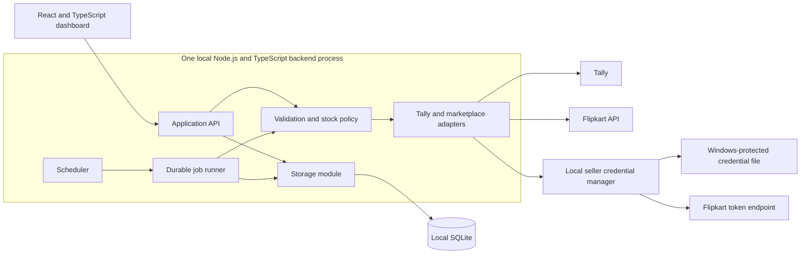

# Tally to marketplace inventory architecture

**Status: Approved target architecture.** The seller approved the architecture and dashboard layout on 2026-11-07. The delivered Inventory workflow supports reviewed publication and automatic updates for eligible mappings using the selected Tally company balance. Positive order-tracked allowances, selected godowns and production recovery remain open. The diagrams below include these longer-term workflows. [Delivered scope](../../README.md)

## Current marketplace management delivery

The seller approved the separate [account/listing flow](marketplace-listings.md) on 2026-11-18. Marketplaces works independently of Tally setup and shows explicitly added accounts with separate protected credentials, seller bindings and all-state listing imports. Search and status filters cover the last complete import. Live Apply sends only the selected stock/location or price edit; fresh reads check conflicts and the result. Sample mode makes no external request.

A direct stock edit in Marketplaces pauses automatic stock publication for the mapped seller, listing and location. A later Tally purchase, Tally sale or verified Flipkart order cannot trigger an automatic write to that location while paused. Flipkart can still deduct customer orders. Resuming clears the location’s pause and replaces its saved proposal with a fresh calculation using the stock available to that listing. If verification fails, clear the old proposal and show the reason on the row. The same rule applies with company sync off. If company sync is on and the mapping is eligible, the next sync pass checks the current target under the saved policy and can publish it. Company sync is enabled separately.

An existing sales allowance constrains direct stock edits. Positive live Limited sales updates are blocked while order reconciliation is unfinished. The seller can explicitly return the destination to Auto before applying; this removes the allowance. An already paused location stays paused. Changing policy alone sends no stock. Price-only edits leave automation unchanged.

Schema 4 persists mapping choices, package observations and pending Tally stock changes alongside durable marketplace attempts. Writes are serialized per account. An unfinished attempt becomes uncertain after restart. Fresh Tally and marketplace reads are required for live Inventory publication. Offline restore preserves seller bindings, clears freshness, pauses listings and disables company automation.

## Outcome and scope

Run on the Windows machine that can access Tally. Start with Flipkart tyre listings, homogeneous packs, and existing products/listings. Show every stock item in the selected Tally company, including unmapped items, then associate listings with their source item. Keep companies separate and explicitly select which Tally stock locations supply each marketplace inventory location. The current connector supports an explicit choice of the whole company balance for a particular marketplace location. Individual godown selection still requires a godown source reader.

Each eligible duplicate listing and pack draws on the same item's available balance after its keep-back and known unbilled orders across participating sellers. Listings share that balance, so simultaneous sales can exceed it between checks. The seller can explicitly enable the tyre advertising minimum of five whenever at least one complete pack is available. The reported one-unit cart restriction remains a seller-provided operating assumption.

Additional marketplaces, remote hosting of the inventory backend, and multiple users are future extensions. Account identity is explicit throughout so adding seller accounts does not require redesigning the stock model. The current seller-owned self-access branch keeps authentication on the customer's Windows computer; the earlier provider-managed model remains an alternative if Flipkart requires it for distribution. See [ADR 0004](../adr/0004-seller-owned-flipkart-self-access.md).

The seller approved the separate [marketplace listing-management flow](marketplace-listings.md) with account tiles and multiple Flipkart accounts. It is implemented as described above and preserves the Inventory policy rules below.

### Matching Flipkart orders to Tally sales bills

The tracked billing check reads available Flipkart order items for the selected seller from the company's saved date across Standard, Self-ship, Express, Smart and Fulfilment by Flipkart. It checks the fulfilment profile and shipment type returned by Flipkart. A verified match shows the Tally bill number and date. Unmatched sales and exceptions stay visible. The recent billing preview and the stock reservation reader cover standard and self-ship seller-fulfilled shipments.

The tracked check reads the participating sellers needed to resolve claims on the same bill. The count for each fulfilment type comes from the selected seller's shipment check. **Unknown** means that check failed. An incomplete invoice lookup or another participating seller's failed check leaves a numeric count beside a warning. Readable shipments remain in the tracked list. Automatic order-ID and order-item-ID matches can use shipment evidence. Invoice-based matches require verified invoice evidence. Inspecting a voucher also checks its references against other orders. A targeted retry repeats the affected reads for that type through the original cutoff, merges observations by order item and checks competing claims again. An expired check requires a fresh read.

On 26 November 2026 the provider confirmed that all current customers keep their stock on their own premises until a Flipkart delivery partner collects it after a sale. Courier pickup alone does not identify the order's Flipkart fulfilment profile or a Tally godown. Stock reservation for additional fulfilment types remains open. When the first customer using a Flipkart warehouse is onboarded, confirm how that customer records transfers and sales in Tally and which balance supplies each location before choosing a warehouse reservation rule. Warehouse orders are already in scope for bill matching.

The seller configures the sales ledger for each Tally company and Flipkart account. Ledger names can differ between customers. Flipkart establishes the existence of an order. A posted, stock-affecting sales voucher booked to the selected ledger supplies billing evidence for the corresponding quantity. A shop sale or a ledger posting alone cannot establish or consume a Flipkart order.

The recent preview, tracked history and stock calculation must agree when known orders compete for the same voucher deduction. An unreadable invoice on a compatible sale can require review even when that sale falls outside the preview. A failed retry replaces the earlier observation for that fulfilment type. Evidence independently verified for another type remains available. A cancellation can release stock only when the order history is consistent with cancellation before dispatch.

A read-only review compares recent eligible seller-fulfilled orders with sales bills from that ledger. The seller chooses the Flipkart identifier (order, order item or invoice number) and its Tally field (reference, voucher number or narration), or chooses manual matching. Match the listing identity and location, verified Set of, Tally stock item, unit, and actual quantity. One unique exact match can be shown as billed. Ambiguous orders, missing evidence, and shared ledgers require review. Manual confirmation assigns one voucher/item total to one order item and must be revalidated against the evidence on each review. Sellers can release that assignment. Unsupported partial or consolidated billing stays unresolved.

A seller who knows the Tally voucher number can look it up for a single unresolved order item, including a saved order outside the recent preview. A conflicting Flipkart reference requires the seller to compare both values and explicitly confirm the discrepancy. The voucher must be posted on or after the sale’s Indian calendar date and show the required item, unit and outward quantity in the configured ledger. An existing assignment or evidence that the voucher belongs to a different order prevents confirmation. Saving and releasing the link affect the selected order’s billing evidence. The saved matching rule and the Tally voucher remain independently managed.

After setting up the ledger, the customer can save a billing start date for the Tally company independently of stock reservations. The date starts at midnight in India and applies across participating sellers. A company with confirmed starting stock uses that date for both. Saving the date and returning to Order matching both open the full tracked check from that date through its cutoff, using shorter search windows as necessary. The recent preview is available while setting up or changing a seller’s ledger and reference rule.

The seller works from one tracked list. **All**, **Unresolved** and **Billed** filter the same seller, order period and fulfilment types. Search covers Flipkart order number, order item ID and verified Tally bill number. Each verified match shows the bill number, bill date and match method. **All** retains verified cancellations and **Unresolved** includes active unbilled sales, unmapped orders and exceptions. Checks for competing claims include retained orders across participating sellers when checking bills after mapping and when checking a recent sale outside the other order’s preview period.

An eligible order with an identified listing and pickup offers mapping on its row. The seller confirms the Tally item and historical Set of, and the tracked list rechecks bills. A billing-only mapping identifies the item and quantity to match for that seller, listing and pickup. It has no confirmed stock source and stays paused for stock updates. The seller can separately confirm its stock source in Inventory. Mapping a covered Standard or Self-ship order after setting starting stock uses the existing stock-mapping rules.

Starting stock requires separate confirmation of earlier sales, the physical stock being supplied, and the mapped listings' Set of. Stock tracking covers participating normal and self-ship seller-fulfilled orders even with company sync off. Saved orders survive a shortened search or restart. A gap of over 30 days between complete stock checks requires reconciliation and a recent starting date. Flipkart has not guaranteed order-history retention.

A forward order can reserve stock before dispatch. Flipkart sometimes omits the courier-return flag at this stage. Accept that omission only on a pre-dispatch search with a supported pre-dispatch item status, a confirmed seller fulfilment profile and shipment type, explicit evidence that the order is neither held nor a replacement, and a known order item, listing, pickup location and quantity. Cancellation, return evidence or conflicting observations still prevent counting the line as an ordinary sale. After dispatch, an absent courier-return flag leaves the sale unverified. [Flipkart order evidence](../integration/flipkart-validation.md#order-evidence-for-tally-billing-review)

An order for an unmapped listing remains available for mapping by seller, listing and pickup location. Existing mapped stock keeps syncing. If the unknown listing sells the same tyres, the shared quantity can be overstated until the sale is mapped or billed. The first mapping of that destination preserves the tracking date: apply the confirmed historical Set of, check the saved orders against the company’s configured seller ledger, and count unbilled units once across the mapped item’s listings. Changes to established conversions, seller identities or billing rules still require review. A newly mapped destination follows company sync unless paused. A pause applies only to publishing there. [Gradual mapping decision](../adr/0008-map-listings-as-orders-arrive.md)

For each stock item, subtract the seller's keep-back and the base units of all covered unbilled orders from the latest Tally balance. Apply the keep-back once per item, in its Tally base unit. All mapped marketplace listings draw on this shared balance. An order for a pair reserves two tyres. Use at least zero available units, then apply the destination's pack conversion, tyre advertising rule and stock policy. With zero kept back, a purchase can take Tally from four to six while one tyre is waiting to be billed. In that case five tyres are available. When the matching Tally sale lowers physical stock to five, five remain available. An eligible cancellation before dispatch can release the reservation. A return, conflicting identities, an ambiguous bill or missing stock evidence requires review before positive calculated publication.

A recheck of saved orders reads the selected seller and any participating account that shares its ledger or the orders’ Tally stock item. Matching can use two consistent live balance reads even if a recently posted bill has changed stock since the Inventory screen last refreshed. A partial seller check keeps the last complete company check date.

The live publication check reads all participating sellers and verifies Tally balances around the ledger reads. The selected item must agree with the current local balance, and Stockbridge rechecks setup and seller access before dispatch. Each destination also receives its normal marketplace conflict check. A reviewed calculated quantity must still equal the verified target before it can be sent. An expressly entered quantity is a seller decision to publish it and pause that destination. Source checks and marketplace updates are separate requests. Orders arriving between them and provider reporting delays remain exposure.

### Inventory from first connection through restart

1. When Tally is running with the selected company open, the first successful stock read shows its items and quantities in Inventory. Items appear before the seller connects Flipkart or maps a listing.
2. After a successful Flipkart listing import, the seller can link one Tally stock item to one or more existing listings in that seller account. Each listing has its own confirmed **Set of** number and source (package count or seller-entered number).
3. On a normal stop and restart in the same workspace, load the saved mappings, confirmed numbers, sources and any pending package-count reviews into Inventory. The seller can see them while connections refresh and only needs to revisit a mapping when its identity or supporting evidence requires review. Compare refreshed package counts with the saved confirmation, including changes made while Stockbridge was stopped.
4. Publishing a manual Inventory quantity, including zero or an exact match, pauses only that seller’s listing at that location and preserves its existing stock policy. Saving it is a draft action. Explicit Calculate replaces the draft using current stock availability and prepares a resume for a paused listing. Publish verifies the reviewed quantity before resuming. A calculated zero on an active listing leaves it eligible for later restock. A Tally stock change discovered during polling or after restart recalculates eligible destinations. [Reviewed stock and sync](../adr/0009-review-stock-and-sync-together.md)

## Application boundaries

| Module                   | Responsibility                                                                                                                                                                                                                              |
| ------------------------ | ------------------------------------------------------------------------------------------------------------------------------------------------------------------------------------------------------------------------------------------- |
| Dashboard                | Company/account context, item/listing rows, observations, editable proposals, review, actions, settings and searchable history. Accept credentials only for submission to the local backend; never retrieve saved secrets or access tokens. |
| Application API          | Apply user commands, scope actions, validate versions, persist settings/drafts/policies and create durable jobs. Bind to loopback by default.                                                                                               |
| Policy and validation    | Verify identities, mappings, units and pack evidence; calculate complete packs and the named Flipkart tyre policy; apply sales allowances. Shared by manual and automatic publication.                                                      |
| Scheduler and job runner | Poll sources, discover items, observe orders, reconcile sales allowances, process publication and verification, retry safely, and run backups. Modules in the same backend process, with work saved in SQLite.                              |
| Adapters                 | Hide Tally and marketplace authentication, transport, response validation, pagination, locations and API-specific batch/results handling. Preserve source identifiers and observation times.                                                |
| Storage                  | Own schema migrations, bounded transactions, observations, operational records, business history and consistent backups. Keep business policy independent of SQLite-specific queries.                                                       |

The backend continues when the dashboard closes. Windows startup, controlled shutdown, restart after failure, upgrades and protected credential access must be packaged and verified. The application runtime and dependency versions are selected in [package.json](../../package.json) and [package-lock.json](../../package-lock.json). Windows lifecycle hosting and durable publication-job implementation remain to be selected and delivered; type checking does not replace validation of external responses.

The seller-owned route accepts an application registered by that seller under Flipkart Self Access. The local backend requests tokens directly from fixed HTTPS endpoints and protects each account’s credentials with Windows current-user encryption outside SQLite and portable backups. Tokens remain in memory. No hosted callback or provider secret is required. Token issuance alone does not establish seller identity; complete listing import binds and verifies the seller before direct edits. Credential changes and restart require another successful import. Local disconnect removes saved access without revoking the application at Flipkart. The [provider-managed alternative](../adr/0003-provider-managed-flipkart-authorization.md) and [distribution eligibility distinction](../adr/0004-seller-owned-flipkart-self-access.md) remain separate.

## Durable identities and state

Use internal stable IDs and retain verified external IDs. Names, display titles and SKU text are labels, not global identity.

| Record                                            | Identity and retained facts                                                                                                                                                                                                                          |
| ------------------------------------------------- | ---------------------------------------------------------------------------------------------------------------------------------------------------------------------------------------------------------------------------------------------------- |
| Tally company, stock item and stock location      | Stable company identity; item and location identities scoped to that company. Store base units and source identity evidence. Verify rename, restore and reconnect behavior before relying on a Tally identifier.                                     |
| Seller account, listing and inventory destination | Marketplace plus verified seller account identity; listing identity within that account; destination additionally includes marketplace location. Retain seller SKU/product references without treating a SKU as unique across accounts.              |
| Stock mapping                                     | Company/item, explicitly selected source locations, destination, verified pack size, evidence/source/time and mapping version. Block ambiguous or contradictory mappings.                                                                            |
| Observations                                      | Tally stock, marketplace stock and order observations with source time, fetch time, version and validity/freshness. Keep observed stock distinct from desired and confirmed stock.                                                                   |
| Active policy                                     | Auto or Limited sales, a separate Pause flag, the company automation setting, and policy history. The remaining allowance survives a pause.                                                                                                          |
| Allowance and consumption                         | Exact seller-account/listing identity, granted listing units, activation baseline/generation, remaining units and durable order-item consumption records. Never share a deduction with sibling listings or infer a sale from a stock balance change. |
| Proposal and bulk review                          | Exact destination set, calculated or manual quantity, pending resume for a paused destination, captured source/mapping/rule/policy versions and review status.                                                                                       |
| Job and publication attempt                       | Destination, cause, desired quantity, policy/source versions, retry/verification state and per-destination outcome. Preserve uncertain in-flight outcomes across restart.                                                                            |

Publication is location-specific. Order attribution must resolve the exact listing and any location attribution required by the configured policy; unresolved attribution blocks affected allowance reconciliation rather than charging another listing or silently inventing a per-location allowance split.

## Calculation and publication precedence

Evaluate every dispatch again; a reviewed proposal is not an exemption from current validation.

1. **Connection and validation:** require authenticated destination access, verified company/item/account/location/mapping/pack identities and fresh required source data. With Tally unavailable, retain marketplace values and show stale/offline status; refresh before resuming. Missing or invalid inputs are blocked, never fabricated as stock zero. Limited-sales increases additionally require current order reconciliation.
2. **Publication permission:** automatic work requires company automation enabled and the listing not Paused. Pause blocks **all** automatic writes, including stock-zero changes and exhausted-allowance corrections. Observations, order accounting and alerts continue. Explicit manual publication remains available through the same validation path. Restore recovery separately blocks outbound work until reconciliation/review.
3. **Active policy:** an exhausted allowance targets zero. A positive allowance limits only its exact listing. Routine refresh, bulk calculation, restart and retries preserve these policies; changing back to Auto or granting new allowance is explicit.
4. **Stock calculation.** With a verified Tally balance `P`, unbilled base units `U`, the seller's per-item keep-back `K` (default zero), and confirmed pack size `S`, calculate `completePacks = floor(max(0, P - U - K) / S)`. If Tally changes the base unit of an item with a positive keep-back, retain the previous amount and unit for review. The same confirmation applies to a positive amount recovered from an older workspace whose original unit cannot be established. Before Stockbridge calculates stock or submits a positive direct update at a mapped location, the seller enters the amount in the item's current unit. Saving confirms that amount across restarts. A saved zero needs no unit confirmation. A saved keep-back may exceed today's balance and still applies after a restock. The optional Flipkart tyre floor raises positive pack counts below five to five. Zero complete packs always gives zero. Limited sales also requires a verified remaining allowance.
5. **Trigger and current job:** publish only for an eligible cause and current versions. A Tally balance change, saved keep-back change or explicit publication can raise or lower the listing. Saving the keep-back queues its eligible listings for the next sync, including when the Tally balance is unchanged. A newly verified Flipkart order queues a decrease check for all eligible destinations sharing its Tally item. Each check compares the calculated quantity with fresh marketplace stock. A lower remote quantity stays in effect. Limited sales also reconciles the remaining allowance. Never replay an obsolete positive quantity after a newer zero or policy change.

The Inventory **Set of** column holds the number of mapped Tally base units consumed by one sale of that Flipkart listing. This conversion applies across product categories. With one individual tyre in Tally and **Set of = 2**, there are zero complete sets and the proposed Flipkart stock is zero, including under the tyre advertising policy.

Show the catalogue set quantity when available for the exact product variant and fetch the actual shipping package count from listing details as fallback evidence. In the column, the seller can choose **Use package count** when the reported count equals the Tally units used by one sale, or **Enter a number** to specify a positive whole number of Tally units. A two-tyre set shipped in one parcel uses a custom value of two when Tally counts individual tyres. If the package count is missing, manual entry remains available. Show which source supplies the chosen value and retain the listing identity, mapped item, base unit and verification time. The choice controls the local stock calculation. Saving it recalculates the proposal through the existing review and publication flow.

Compare the physical product and base unit with the exact listing and product identity when confirming a mapping. For tyres, check the brand, model and dimensions. SKU suffixes, digits in a title, package IDs and package order cannot establish pack size. Changes to evidence on which the mapping relies require rechecking the affected mapping.

On each catalogue refresh, save the latest valid package count and check time for the same seller account, listing and product ID. Keep this observation separate from the confirmed **Set of** value and its source. Apply these rules in Inventory:

- **Use package count.** Compare the latest valid count with the count the seller confirmed. If it changes from two to one, show **Set of 2 · Review needed** in that listing's cell, with the message **Flipkart package count changed from 2 to 1**. Hold publication of calculated stock for that listing until the seller selects **Use 1** or **Keep 2 as my own value**. The second choice changes the source to manual. Recalculate the proposal after the choice.
- **Enter a number.** Keep the seller's number in effect when only the shipping count changes. Display the latest count alongside it. For example, two tyres shipped together still consume two individually stocked Tally tyres per sale.
- **Package count unavailable.** If the request fails or supplies no usable count, retain the confirmed value and last valid observation. Show **Package count unavailable** and the last successful check time when available. Record a count change only after receiving a valid count. Publication still follows the freshness requirements above.

## Modes and operations

Saving the same confirmed mapping preserves its pending work and existing proposals. A seller can review Set of without refilling stock that has already sold on Flipkart. A pending Tally update cannot refill a destination paused by a reviewed manual publication. An uncertain stock request requires evidence of completion or non-dispatch before the seller can approve a recovery.

| State or action        | Effect                                                                                                                                                                                                                                                                                     |
| ---------------------- | ------------------------------------------------------------------------------------------------------------------------------------------------------------------------------------------------------------------------------------------------------------------------------------------ |
| Auto                   | Recalculate on Tally stock changes. A verified sale queues a decrease-only check across all eligible shared listings. A marketplace quantity difference alone cannot trigger a refill.                                                                                                     |
| Limited sales          | Allow a finite number of additional listing units, each one complete pack. Automatic stock changes remain active within physical availability and remaining allowance.                                                                                                                     |
| Allowance used up      | Keep the desired quantity at zero until explicit new allowance or Auto. If marketplace stock becomes positive, queue and verify zero when automatic publication is permitted. Show pending/failed correction until confirmed.                                                              |
| Pause / Resume         | Pause stops all automatic publication while observations and allowance consumption continue. Resume reads fresh stock and relevant orders, revalidates, and recalculates with the current policy. Parent actions affect their mapped listings and show mixed child state where applicable. |
| Edit proposed quantity | Saving a typed quantity or using Set to zero creates a manual draft. Accepted manual publication pauses that destination under its existing policy.                                                                                                                                        |
| Calculate / Refresh    | Explicit Calculate replaces the selected or filtered drafts with fresh calculations. A paused destination stages a resume. Background refresh only updates calculated drafts and preserves seller edits. Refresh also imports newly discovered Tally items.                                |
| Review and publish     | Discard clears one captured proposal. Publish checks the remaining destinations against current quantities, mapping and marketplace evidence. A calculated resume requires verified stock. A changed quantity needs a fresh review.                                                        |
| Remove mapping         | Default: prevent positive jobs, reconcile in-flight work, explicitly send zero and verify before unlinking. Failure leaves a visible pending removal. Alternative: explicitly leave remote stock unchanged and stop managing it. Never delete either product.                              |

Mode, Pause, connection health, validation status and publication result are separate fields: a listing can be Paused, offline and awaiting confirmation simultaneously. Use text/accessibility labels, not colour alone.

## Allowance activation and sales accounting

Consume allowance at the **first qualifying approved Flipkart order observation, before Tally billing**. Consume the order item's quantity in listing units, not tyre base units. Persist stable account/order-item identity and already consumed quantity so repeated polls, notifications, status changes or retries cannot deduct again. A later Tally bill affects physical-stock calculation only; it does not consume allowance again. Do not subtract the sale a second time from marketplace-observed stock or write a corresponding stock deduction into Tally.

Activation must save a durable generation and baseline that excludes previous orders while accounting for orders arriving during publication. Reuse that activation on retry. Reconcile relevant orders before any increase that could reuse already consumed allowance; stale order coverage blocks increases. Exact status mapping, available-versus-pending inventory semantics, discovery coverage and activation boundary handling require authenticated integration evidence before enabling this feature.

Purchases, cancellations and returns never replenish allowance automatically. Show them for review. Exhaustion stays at zero until explicit action. Publication failure leaves the desired policy active with an honest pending/failed remote result. Pause can delay zero enforcement, and observation/API latency means zero cannot be guaranteed continuously between checks.

## Review, bulk actions and background work

An imported seller SKU can be mapped before Flipkart returns a stock location. The seller can confirm an enabled pickup location from that account’s catalogue during mapping or later. Until chosen, the SKU mapping retains its Set of and publication waits. An absent location carries unknown stock. The first stock update uses the confirmed pickup ID and requires the usual identity, policy and readback checks.

Parent rows show unique Tally stock items. Each child shows a mapped listing and its location-specific inventory. Display source quantity, title/SKU, the **Set of** column, observed quantity/time, proposed quantity and row actions. Low-stock highlighting defaults to five or fewer physical base units, configurable per item.

When Flipkart supplies a public product URL for a matched listing, show an external-link icon beside the child row’s SKU. Open the supplied product page in a new tab. Demo rows and listings awaiting a product URL show the SKU alone.

Within each parent, sort listing rows numerically by the displayed **Set of**, with unknown sizes last. Equal sizes sort by seller SKU and then pickup location. A new package-count observation awaiting review keeps the row at its saved **Set of** until the seller confirms a change.

Bulk actions use selected listings when any are selected; otherwise all filtered matching listings across pages. Review captures the company, accounts, listing locations, quantities and intended actions. Later filter and stock changes leave that review fixed. At dispatch, verify each destination, source, policy, current marketplace observation and quantity. A change in the underlying balance or reservations may yield the same calculated listing quantity. The captured action can proceed when its meaning and other checks still hold. If the quantity differs, skip that write and preserve the newer proposal and pending automatic work. Changes to the mapping, pack definition or publication action require a new review. Publish remaining eligible destinations independently. A fresh review from the results covers only the affected destinations the seller chose.

Compare a calculated proposal with the last observed stock for its exact seller, listing and pickup location. When these quantities match and the destination has no pending resume or other required check, report the match and exclude it from the publication count. A paused listing with a proposed resume remains reviewable at equal quantities. With only matches in scope, Calculate finishes without a publication step. With a mixed selection, present the remaining proposals for review and the reasons for blocked rows. An unknown observation requires a destination check, including the first update to a confirmed pickup location. A saved manual proposal retains the seller’s intent even when the quantities match. A comparison with a saved observation leaves pending stock checks in place.

When a seller maps a listing with a waiting tracked order, or a verified sale first appears for a mapped listing, Stockbridge checks the order and Tally bills to create the destination’s first calculated proposal. This also works with company sync off or the listing paused. If verification is temporarily blocked, the pending check survives a restart. Saving a seller-entered draft preserves the requirement to verify the order before publishing a calculated quantity, including zero. A different shipment ID reported for the same order item requires reconciliation before a cancellation can release its reservation.

The order’s unbilled units reduce available stock across all mappings for the same Tally item. Changes to reservations, stock or listing setup refresh existing calculated drafts using the same availability rules. Background refresh cannot grant permission to resume. A blocked refresh keeps the previous quantity and records the reason on the listing. A seller-entered draft takes precedence over the automatic calculation. With company sync enabled, an order-triggered check can lower an eligible, unpaused destination whose observed quantity exceeds the new target.

Company automation covers mapped seller accounts and locations across the company. The enable preview shows the observed and calculated quantity for each ready destination, with reasons for waiting or paused destinations. Approval is bound to the reviewed scope and stock evidence. New eligible mappings follow the company setting. A seller can instead approve one calculated publication at an exact seller location while the company is off. This trial preserves saved proposals and policies and uses normal destination verification and uncertain-write handling. [Company sync and listing trials](../adr/0006-company-sync-and-listing-trials.md)

Tally discovery establishes whether the endpoint is reachable. A subsequent failure reading one company keeps its last successful timestamp and blocks publication from that company’s cached stock. Commit complete, verified snapshots for healthy companies independently. For Calculate, reject an invalid or cross-company request as a whole. Within a valid selection, save successful drafts and identify blocked listings. A shared stock uncertainty applies to every destination that depends on that evidence. Background refresh preserves seller-edited drafts. An explicit calculation that cannot verify a new quantity reports the reason for that row.

Company automation settings are independent of the displayed company. New workspaces default to one minute for **Tally stock**, five minutes for **Marketplace orders** and one hour for **Listings**. Each timer waits until the preceding run finishes before counting down again. Settings changes apply to future runs without restarting Tally or Stockbridge. Upgrades retain the saved intervals. Failed checks can delay the next run.

**Refresh inventory** requests the selected company’s current Tally balance and a catalogue import for each participating seller, including the explicitly selected seller when eligible. If a catalogue import is already running for that seller, the request can use its result. With starting stock confirmed, the refresh checks orders and reservations from the company’s tracking date. Publication follows the existing company sync, listing pause, stock and order verification rules. The result identifies successful checks, problems with individual sources and the outcome of any pending updates. The **Connections** discovery action remains available for reading the loaded Tally companies.

Save jobs before sending. Serialize publication per destination, supersede obsolete queued quantities, and revalidate immediately before dispatch and retry. Give zero updates priority without violating destination ordering. Check each SKU/location outcome even after HTTP success; verify resulting marketplace stock. A timeout is an uncertain result to reconcile, not proof of failure. After outages or restart, refresh affected sources and policies before resuming pending work. Store the order receipt and its affected destinations together so an interruption cannot lose a sale or queue it twice. See [stock recovery after an uncertain update](../adr/0005-recover-uncertain-stock-updates.md) for the seller-approved recovery rule. One process owns publishing initially.

## Backups, restoration and history

A same-PC application upgrade continues the existing workspace, including its company sync settings, listing pauses and remaining allowances. Eligible automatic publication follows the ordinary fresh-stock and order checks. If dashboard startup fails after migration, retry startup through the new package and retain the pre-upgrade safety copy. Restoring earlier stock state requires a separate support decision because marketplace orders and stock may have changed since that copy was made.

Create consistent SQLite snapshots daily, before upgrades and on Back up now. Initially retain seven daily and four weekly backups. Verify the completed snapshot and manifest before declaring success or rotating older backups. Include settings, mappings, observations, policies/allowances, durable recovery records and retained business history. Exclude credentials from portable backups by default; protect them separately and reconnect accounts when needed. Export raw diagnostic logs separately.

Settings shows the backup folder, schedule/retention, last/next backup, failures and restore/import actions. Validate background-process write access when changing the folder; future backups use it immediately without restart. Existing files stay put unless the user explicitly requests a move/export. Keep manual and pre-upgrade/pre-restore safety backups distinguishable; their exact retention is an implementation choice.

Restore is replacement of this app's local state, not a merge or rollback of Tally/Flipkart. Validate the selected backup in staging, show its date/version/identities/counts, obtain the product's restore confirmation, stop publication, reconcile or record in-flight uncertainty and take a verified safety backup. Replace the database under exclusive access. Preserve this machine's connection/backup-path settings; do not import another machine's paths blindly.

Keep restored outbound work paused. Mark stock and drafts stale, clear pending instructions to resume a destination and prevent replay of restored pending jobs. Fetch fresh Tally stock, marketplace stock and order history; verify identities; reconcile restored policies with the preserved current state. Reconstruct allowance consumption across the backup gap so an allowance consumed after the backup cannot reopen. Show a reconciled review before resume. If order or policy history is insufficient, require explicit review/reset of affected listings instead of guessing. Database integrity alone does not establish safe restored stock.

Keep searchable business/item history for 90 days and rotated technical logs for 30 days initially, both configurable with export. Explain calculations, policy changes, publishing outcomes and settings changes. Diagnostics include time, level, module/operation, company/listing, run ID, duration, retry and errors; provide filters, search and bounded debug mode. Exclude credentials and unnecessary customer personal data. Log-retention cleanup must not delete active allowance/order deduplication records, unresolved jobs or pause state needed for correctness.

## Evidence and remaining integration checks

The [interview evidence](inventory-sync.md#official-source-findings) records official-source review and [observed package examples](inventory-sync.md#live-pack-size-evidence-from-hingadtyres). Those establish documented capabilities and inspected UI values, not authenticated access for this installation.

| Established evidence                                                                                                                                              | Still to verify before production use                                                                                                                                       |
| ----------------------------------------------------------------------------------------------------------------------------------------------------------------- | --------------------------------------------------------------------------------------------------------------------------------------------------------------------------- |
| Flipkart documents location-specific absolute stock writes, batches of up to ten SKUs and per-SKU outcomes.                                                       | Intended account authorization, actual response behavior, locations, throttling, inventory availability/pending semantics and read-after-write verification.                |
| Listing details document `packages[]`; order details document order-item/listing identity and quantity. A set-of-two listing was checked against its UI packages. | API package agreement, per-listing fallback eligibility, exact approved status, order discovery completeness, location attribution and allowance activation/reconciliation. |
| Tally documents company-scoped XML and JSON support from TallyPrime 7.0; live access needs Tally running with a company loaded.                                   | Installed version, supported interface, stable IDs, units/godowns, source-location extraction, stock effects of edits/deletions/adjustments and read performance.           |
| The seller dashboard displayed HINGADTYRES.                                                                                                                       | Verified API seller identity and credentials. Browser sign-in is not application authorization.                                                                             |

## Future migration and delivery milestones

Keep the dashboard behind the backend API and connectors/storage behind module boundaries. Later, the backend can move to a server and SQLite can migrate to a server database such as PostgreSQL. A local Tally connector then communicates over authenticated HTTPS. This requires validated data conversion, query/transaction/job adaptation, secure access, offline recovery testing and a controlled cutover with one active publishing owner; it is not a database-URL switch.

1. **Consolidated review - complete:** architecture and dashboard layout approved on 2026-11-07.
2. **Read-only integration discovery:** verify Tally/account identities, stock locations, pack evidence and order semantics using the actual installation and authorized account.
3. **Initial local foundation and review workflow - delivered:** settings, storage migrations, source observations, dashboard, drafts and scoped bulk review, within the [current README scope](../../README.md). Live mapping/location evidence and the later publication workflows remain outstanding.
4. **Manual publishing and durable recovery:** per-destination results, verification, ordering, stale-proposal protection and safe mapping removal.
5. **Automation and allowances:** polling, Pause/Resume, deduplicated order accounting, generation/baseline reconciliation and allowance enforcement.
6. **Operational readiness:** verified Windows lifecycle, credentials, backups/restore, history/logging and controlled end-to-end acceptance.

## Customer release completion

On 2026-11-08, the user clarified that the first customer delivery must contain the complete setup and operating workflow. Verification against the customer's actual Tally installation happens during onboarding; it is not a reason to leave application features unfinished. The current pilot with direct marketplace management does not yet satisfy this complete synchronization release requirement.

- Deliver the first-release setup journey from installation through Tally connection, company and source-location selection, seller authorization, listing import, pack/location verification, mapping, reviewed publication and automatic operation. Include actionable connection errors, retry and a way to resume incomplete setup.
- Complete the approved publication, order/allowance accounting, manual-zero pause, recovery and safe mapping-removal workflows. Stored settings, sample interactions and calculation helpers alone do not count as working integration features.
- Deliver a customer package, independent persistent data location, background startup/restart, protected credentials, scheduled/manual backups, verified restore, controlled upgrades and the corresponding user guide. Customers should not need a development toolchain for routine installation.
- Support a fresh customer installation with that customer's own seller identity and settings. Keep HingadTyre's accepted tyre policy scoped explicitly; do not silently apply it to other sellers. Flipkart tyre listings remain the first-release scope; additional marketplaces, remote hosting of the inventory backend and multi-user access remain future extensions.
- Exercise the whole application workflow with controlled integration fixtures and failure/restart/recovery scenarios before customer setup. On the customer machine, verify actual Tally identities, units, quantities and locations, authenticated seller/listing evidence, and a customer-reviewed marketplace write before enabling routine publication. Keep development verification and customer activation evidence separate.

The user initially accepted provider-managed authorization on 2026-11-08, then requested a separate seller-owned self-access implementation on the same day. The local dashboard, Tally access, stock processing and SQLite database remain local in both approaches. The current branch follows [ADR 0004](../adr/0004-seller-owned-flipkart-self-access.md); the provider alternative in [ADR 0003](../adr/0003-provider-managed-flipkart-authorization.md) still requires its own hosted service and application approval. Self Access removes that hosting requirement, but does not establish permission for third-party distribution or remove the need for real seller/listing verification.

### Open installer onboarding

The user rejected invite-only enrollment on 2026-11-08. Anyone who receives the product can install it and complete the full customer setup. Do not add invitations, activation codes, a Stockbridge signup/account-approval gate, licensing activation or subscription billing to the first-release journey.

The customer installs Stockbridge, opens its local dashboard, enters credentials for an eligible seller-owned Flipkart application, configures Tally, verifies company/location/pack mappings and begins reviewed synchronization when those remaining workflows are delivered. Required marketplace authorization and stock verification remain part of setup; the provider does not manually enroll or approve each customer. Bind the imported seller identity to the local credentials without an extra Stockbridge signup workflow. A shared installer must contain no HingadTyre credentials, mappings or live database.

## Key acceptance scenarios

- Four physical tyres yield two complete pair packs and advertised stock five; three-tyre packs also advertise five when one complete pack exists. Zero complete packs yield zero. Missing pack evidence blocks the affected row.
- Grant one sale to a pair listing: its first approved one-unit order consumes the allowance before billing; repeat observations and the later Tally bill do not deduct again. Sibling listings retain their own policy. Purchases/cancellations/returns do not reopen it.
- Publish a manual zero, then raise the quantity directly on Flipkart. Stockbridge observes the new value and leaves it alone while paused. Resume replaces this location’s draft with a fresh calculation and queues a separate stock check when company sync is enabled. A calculated zero from low stock can recover automatically after a purchase.
- In Auto, a marketplace-only reduction is shown without refill; a verified sale triggers decreases on shared listings, and a relevant Tally change or explicit publication recalculates the full target. Invalid/offline stock is never converted into zero.
- Change stock or pack evidence after editing a draft: preserve the edit, mark it stale and block unchecked publication. Bulk review affects only its captured destinations across pages.
- Restart or time out during publication: recover/reconcile the destination; never send a superseded positive quantity after a newer zero. Report mixed batch outcomes accurately.
- Restore an older backup after an allowance was consumed: publishing stays paused until fresh order/policy reconciliation prevents that allowance reopening. Reject unsafe/incompatible backups without replacing the active state.
- Change an interval or backup folder in Settings: use the validated value for future work without restart, overlapping polls or silently moving old files.

Decision background: [GLOSSARY](../../GLOSSARY.md), [shared-stock policy ADR](../adr/0001-shared-stock-flipkart-tyres.md), [local TypeScript/SQLite ADR](../adr/0002-local-typescript-sqlite.md), [provider authorization ADR](../adr/0003-provider-managed-flipkart-authorization.md), [seller-owned authorization ADR](../adr/0004-seller-owned-flipkart-self-access.md), and [design interview](inventory-sync.md).
